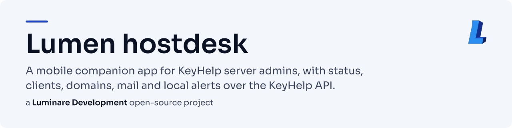

<!-- header:begin: brand-repos 0.1.0, variant studio, files in docs/brand/; the project-page sync drops this block -->
<picture>
  <source media="(prefers-color-scheme: dark)" srcset="docs/brand/readme-header-dark.svg">
  <source media="(prefers-color-scheme: light)" srcset="docs/brand/readme-header-light.svg">
  
</picture>

<!-- byline:studio -->
*a [Luminare Development](https://luminare.tech/open-source/lumen-hostdesk/) open-source project*
<!-- /byline:studio -->
<!-- byline:personal
*by ItsPaulAT · [project page](https://luminare.tech/open-source/lumen-hostdesk/)*
/byline:personal -->

<!-- header:end -->

# lumen-hostdesk

A mobile companion app for KeyHelp server admins: server status, clients, domains, e-mail
accounts, databases and local alerts, over the KeyHelp REST API of your own server. Built with
Expo for Android, iOS and the web, in the Lumen look.

Not affiliated with or endorsed by Keyweb AG. KeyHelp is named only to describe what the app
works with; KeyHelp is a registered trademark of Keyweb AG.

Work in progress.

## Licence

[MIT](LICENSE). The licence covers the code only: the project name, logo, header images
and `docs/brand/` are not licensed (see [NOTICE](NOTICE)).

<!-- byline:studio -->
*a [Luminare Development](https://luminare.tech/open-source/lumen-hostdesk/) open-source project*
<!-- /byline:studio -->
<!-- byline:personal
*by ItsPaulAT · [project page](https://luminare.tech/open-source/lumen-hostdesk/)*
/byline:personal -->
